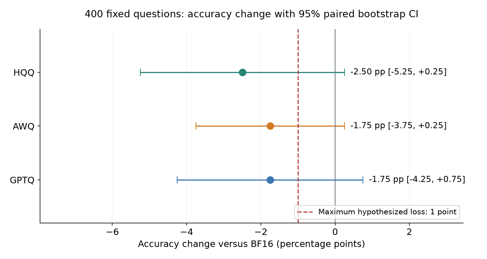
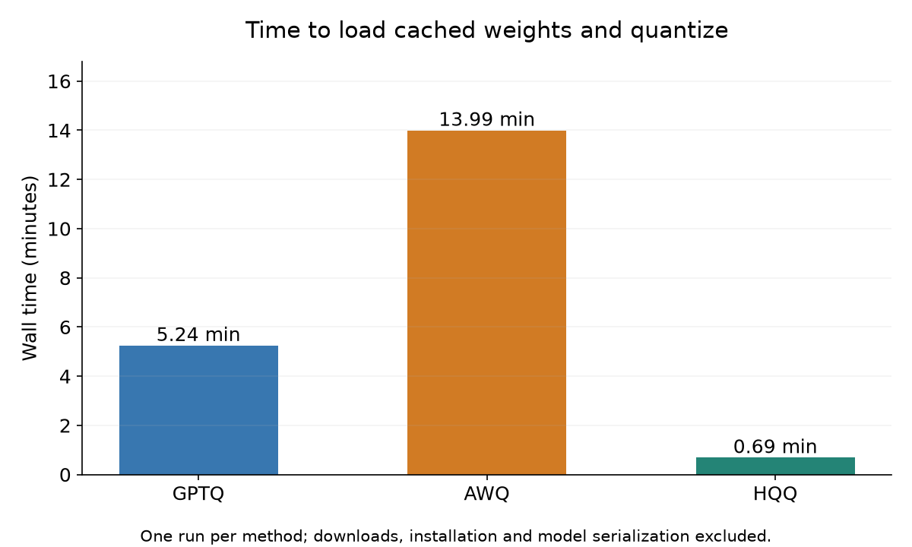
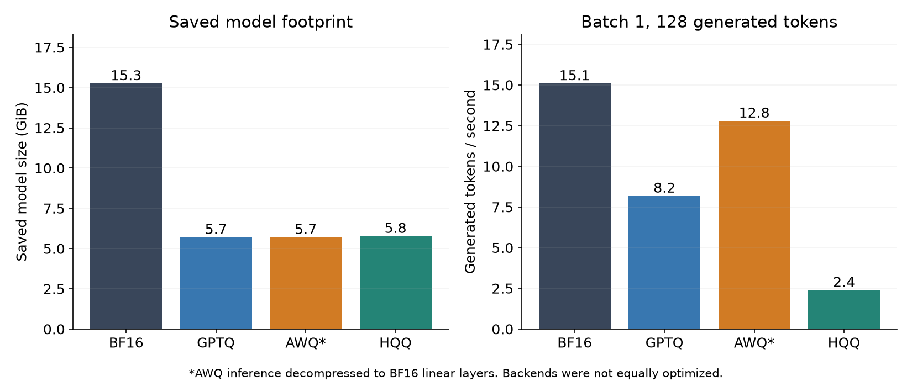

# Three 4-bit recipes, one Qwen3-8B

**The fastest 4-bit recipe took 0.69 minutes and lost 2.50 points.**

HQQ was the fastest successful recipe in this run; its measured accuracy change was -2.50 percentage points across 400 fixed questions. The preregistered full-hypothesis verdict is **INCONCLUSIVE**; the confidence intervals below determine how much of that small observed change we can trust.

I quantized the same public Qwen/Qwen3-8B checkpoint on a single NVIDIA L4 using GPTQModel, LLM Compressor AWQ, and native HQQ, then compared them with BF16. Each recipe used 4-bit weights in groups of 128, with the embedding and output head left at BF16; GPTQ and AWQ shared 128 calibration sequences of 512 tokens from WikiText-2 training, while HQQ used no calibration examples.

**Plain-English takeaway:** HQQ shrank this model in under a minute without calibration, but answered ten fewer of our 400 questions correctly than BF16. This sample is too small to establish a one-point accuracy guarantee for any recipe.

The main table is also available as [an image for Substack](figures/table.png).

| Recipe | Quantize min | Saved GiB | Peak quantize GiB | Peak eval GiB | Tokens/s | WikiText-2 PPL | Combined accuracy % | Change vs BF16, pp |
|---|---:|---:|---:|---:|---:|---:|---|---|
| BF16 | — | 15.26 | — | 15.99 | 15.1 | 12.88 | 79.25 [75.25, 83.00] | reference |
| GPTQ | 5.24 | 5.70 | 2.80 | 6.42 | 8.2 | 13.28 | 77.50 [73.50, 81.50] | -1.75 [-4.25, +0.75] |
| AWQ | 13.99 | 5.69 | 21.14 | 16.15 | 12.8 | 13.25 | 77.50 [73.25, 81.50] | -1.75 [-3.75, +0.25] |
| HQQ | 0.69 | 5.77 | 16.24 | 6.49 | 2.4 | 13.29 | 76.75 [72.75, 80.75] | -2.50 [-5.25, +0.25] |

**AWQ runtime caveat:** the 4-bit checkpoint was decompressed into BF16 linear layers for evaluation; its speed and evaluation memory are not packed 4-bit inference measurements.

Brackets show 95% bootstrap confidence intervals; change intervals use paired question outcomes. VRAM is PyTorch peak allocated memory, measured separately for quantization and evaluation, rather than total process memory reported by nvidia-smi. Saved size includes small tokenizer/config files for quantized recipes and only safetensors for BF16; the original 4-bit formats retain unquantized vocabulary matrices and metadata, so a fourfold file reduction is not implied.

| Recipe | MMLU accuracy %, n=200 [95% CI] | ARC-Challenge accuracy %, n=200 [95% CI] |
|---|---|---|
| BF16 | 66.50 [60.00, 73.00] | 92.00 [88.00, 95.50] |
| GPTQ | 64.50 [58.00, 71.00] | 90.50 [86.00, 94.50] |
| AWQ | 64.50 [58.00, 71.00] | 90.50 [86.00, 94.50] |
| HQQ | 64.00 [57.49, 70.50] | 89.50 [85.00, 93.50] |

The preregistered accuracy condition required every quantized recipe’s paired 95% CI lower bound to be at least −1 point. GPTQ's change was -1.75 [-4.25, +0.75] points. AWQ's change was -1.75 [-3.75, +0.25] points. HQQ's change was -2.50 [-5.25, +0.25] points. A CI that crosses −1 makes the one-point claim inconclusive for that recipe; an interval wholly below −1 disproves it. The full hypothesis additionally requires HQQ to be strictly faster than both other recipes and use no calibration; one timing run per method supplies no timing confidence interval.

All 400 questions were selected before inference with seed 44: 200 from `cais/mmlu` (`all`, test) and 200 from `allenai/ai2_arc` (`ARC-Challenge`, test). The raw zero-shot prompt lists the question and choices and ends `Answer: `; accuracy selects the highest next-token logit among the literal answer letters, with no chat template or generated reasoning. It is an answer-label likelihood test. The 10,000 paired item bootstrap resamples use seed 44 and the identical question order for all methods; these are marginal intervals for this fixed sampling procedure, not claims about all tasks or all MMLU subjects.

Perplexity uses all 584 complete, nonoverlapping 512-token WikiText-2 raw test blocks: 298,424 predicted tokens, resetting context at every block and dropping the incomplete final block. Throughput uses batch 1, a fixed 32-token prompt, exactly 128 greedy output tokens, one warmup and three timed repetitions with CUDA synchronization. Quantization timing starts before method imports and cached model load and ends after quantization; it excludes package installation, model/data downloads, evaluation, debugging, and checkpoint serialization. Each recipe has one measured successful quantization, so timing differences are descriptive.

There was one compatibility failure: Transformers 5.17.0’s HQQ loader raised `NotImplementedError` before quantizing any weights. The repair used the native HQQ `AutoHQQHFModel` API with the same 4-bit/group-128/axis-1 settings; the original traceback is retained in `results/hqq_loader_failure.json`. No library installation failed, and this compatibility repair required under three minutes of work. HQQ's reported successful time excludes that failed attempt and repair. AWQ's first evaluation ran out of memory during lazy decompression; a fresh process successfully evaluated the existing checkpoint. GPTQ's quantization object retained offloaded meta tensors and could not move directly to CUDA, so it too was evaluated from its saved checkpoint in a fresh process. HQQ was evaluated in its native quantized object. These recovery attempts did not repeat calibration or quantization, and their original errors are retained. GPTQ used the default layer offload strategy, which explains its low GPU allocation during quantization; CPU RAM was not measured. Its timing includes first-use CUDA extension compilation.

The principal caveats are sample size, protocol, and implementation. Four hundred questions provide weak power for a one-point noninferiority claim, and subject/topic dependence is not modeled by the item bootstrap. This zero-shot, non-thinking test does not measure Qwen3’s chat or reasoning performance, and the short-context perplexity is not directly comparable with longer-context leaderboard numbers. Throughput compares the recorded library backends rather than equally tuned production engines: HQQ and GPTQ use PyTorch paths. **AWQ's compressed-tensors loader decompressed its packed 4-bit checkpoint into ordinary linear layers for inference**: resident parameter bytes were 16.54 billion and evaluation peak was 16.15 GiB. Thus AWQ's accuracy measures the quantized checkpoint's reconstructed weights, but its throughput and evaluation VRAM describe a decompressed runtime, not packed 4-bit inference. No optimized AWQ kernel was benchmarked; different kernels could change the speed ranking. The recipes also differ in symmetry and rounding/search defaults, and the run order was fixed rather than randomized.

Implementation references: [GPTQModel](https://github.com/ModelCloud/GPTQModel), [LLM Compressor AWQ recipe](https://github.com/vllm-project/llm-compressor/tree/main/examples/awq), and [HQQ native implementation](https://github.com/dropbox/hqq). Exact versions, fixed inputs, per-question predictions, per-block losses, inference module classes, timing repetitions, and scripts are included with this experiment; the model revision is `b968826d9c46dd6066d109eabc6255188de91218`.

Resource use: NVIDIA L4; approximately 1.387 CU, estimated from 54.0 tracked minutes × 1.54 CU/hour. The CLI exposes an account balance rather than a per-session bill; another experiment's session was active, so the account balance decrease is not attributed wholly to this run. Only session `b6-044` was used and it was stopped after collection.
